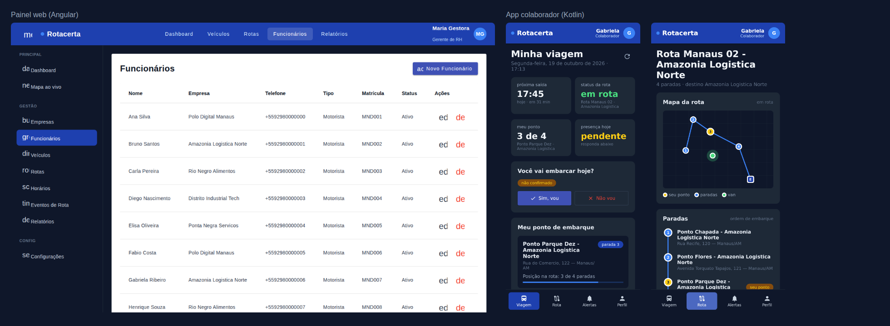

# 📱 Rota Certa — App do Colaborador (Android / Kotlin)

Protótipo do aplicativo **Android nativo** para os **colaboradores** (passageiros do fretado),
feito em **Kotlin + Jetpack Compose (Material 3)** e consumindo a API do
[backend Django](https://github.com/zezinjr/Rota-certa-Backend-Django).

O visual segue **as mesmas configurações do painel web Angular**: topbar `#1e40af` com o logo
“Rotacerta”, layout escuro `#0f172a` com painéis `#1e2937`, badges, botões do tema Material
`indigo-pink`, Roboto e Material Icons. A tabela completa de tokens está em
[docs/DESIGN-TOKENS.md](docs/DESIGN-TOKENS.md).



| Login | Primeiro acesso | Minha viagem | Embarque confirmado |
|---|---|---|---|
|  |  |  |  |

| Rota | Alertas | Perfil |
|---|---|---|
|  |  |  |

> As capturas foram geradas executando este mesmo código Kotlin/Compose contra o backend
> rodando localmente com o seed `seed_manaus_demo` (renderização desktop com fonte DejaVu;
> no Android a fonte é Roboto, como no painel).

## ✨ Funcionalidades

- **Login** com e-mail corporativo (`matrícula@domínio-da-empresa`) e senha — JWT do backend.
- **Primeiro acesso**: troca de senha obrigatória quando `must_change_password = true`.
- **Esqueci minha senha**: fluxo por código (em modo DEBUG o backend devolve o código na resposta).
- **Minha viagem**: próxima saída (a partir dos horários da empresa) com contagem regressiva,
  status da rota (Aguardando / Em rota / Atrasado), ponto de embarque, veículo e motorista.
- **Confirmação de embarque**: “Sim, vou” / “Não vou” / desfazer — o motorista vê no app dele.
- **Van ao vivo, estilo Uber**: card "Sua van está a caminho · ~6 min · 1 parada antes de você · 3,4 km"
  na tela Viagem, que muda para "chegando", "já passou pelo seu ponto" e "chegou à empresa".
- **Mapa (Google Maps dentro do app)**: paradas numeradas (seu ponto em amarelo), empresa e trajeto.
  A van desliza entre as posições e gira para a direção em que está indo. O trecho já percorrido fica cinza,
  e a câmera acompanha a van até você mexer no mapa. Também mostra "minha localização" e a rota a pé
  até o ponto no app do Google Maps. Sem chave do Google Maps, o app usa um mapa esquemático.
- **Trajeto pelas ruas**: com a chave da Routes API configurada no backend, a linha do mapa, o trecho
  percorrido e a previsão seguem o caminho real de carro. Sem ela, o trajeto é a linha reta entre as paradas.
- **Rota**: mapa + timeline das paradas com o seu ponto destacado.
- **Alertas**: eventos da rota (saída, parada, atraso, ocorrência, chegada).
- **Perfil**: dados do colaborador, alterar senha e sair.
- Atualização automática (viagens a cada 30 s, van a cada 5 s, só com o app aberto), renovação
  automática do token (refresh) e ações nativas: ligar para o motorista e rota a pé no Google Maps.

## 🧱 Arquitetura

```
app/src/main/java/br/com/rotacerta/colaborador/
├── data/
│   ├── model/        # DTOs kotlinx.serialization (espelham a API)
│   ├── remote/       # Retrofit + OkHttp (auth header, refresh de token, URL do servidor)
│   ├── session/      # SessionManager (StateFlow) + SessionStore
│   ├── RotaCertaRepository.kt
│   └── AppContainer.kt   # DI manual
├── ui/
│   ├── login/        # Login, primeiro acesso, recuperar senha
│   ├── trip/         # Viagem, Rota (mapa + timeline), Avisos, TripViewModel
│   ├── profile/
│   ├── navigation/   # Fluxo por estado de sessão + bottom navigation
│   ├── components/   # equivalentes Compose dos componentes do painel (.panel, .badge…)
│   └── theme/        # RcColors: tokens visuais compartilhados com o Angular
└── platform/         # MainActivity, Application, SharedPreferences, intents
```

MVVM com `ViewModel` + `StateFlow`/Compose state, Navigation Compose e injeção manual
(fácil de trocar por Hilt depois).

## 🔌 Endpoints usados (backend)

| Método | Endpoint | Uso |
|---|---|---|
| POST | `/api/auth/login/` | Login |
| POST | `/api/auth/refresh/` | Renovar access token |
| POST | `/api/auth/change-password/` | Primeiro acesso / alterar senha |
| POST | `/api/auth/password-reset/request/` · `reset/` | Recuperar senha |
| GET | `/api/me/` | Perfil do colaborador |
| GET | `/api/me/trips/` | Minhas viagens (rota, ponto, motorista, horários, eventos) |
| POST | `/api/me/trips/{id}/boarding/` | `{"status": "confirmed" \| "absent" \| "pending"}` |
| GET | `/api/me/trips/{id}/live/` | Van ao vivo: posição, fase, previsão de chegada e paradas antes de você |

Os endpoints `/api/me/*` exigem Bearer token de uma pessoa do tipo `EMPLOYEE`.

## ▶️ Como rodar

1. **Backend** (na pasta do backend):
   ```bash
   python -m venv .venv && source .venv/bin/activate
   pip install -r requirements.txt
   # .env: DEBUG=True, DATABASE_URL=sqlite:///db.sqlite3,
   #       ACCESS_ACCOUNT_AUTO_INITIAL_PASSWORD=RotaCerta@2026
   python manage.py migrate
   python manage.py seed_manaus_demo
   python manage.py runserver 0.0.0.0:8000
   ```
2. **App**: abra `mobile/colaborador-android` no **Android Studio** (Ladybug ou mais novo, JDK 17+)
   e rode no emulador. A URL padrão é `http://10.0.2.2:8000/api/` (o localhost do PC visto pelo emulador).
   Em celular físico, toque na **engrenagem** da tela de login e informe
   `http://IP-DO-PC:8000/api/` (mesma rede Wi-Fi).
3. **Usuário de teste** (seed): `mne007@amazonialogistica.com` / `RotaCerta@2026`
   (qualquer `mneXXX@<domínio da empresa>` funciona; o 1º acesso pede nova senha).

## 🗺️ Chave do Google Maps

O mapa usa o **Maps SDK for Android** (biblioteca `maps-compose`). Exibir o mapa no app Android não tem custo, mas a chave exige uma conta de faturamento ativa no Google Cloud. A chave **nunca vai para o Git**.

1. No [Google Cloud Console](https://console.cloud.google.com/): crie ou escolha um projeto, ative a cobrança e, em **APIs e serviços → Biblioteca**, ative o **Maps SDK for Android**.
2. Em **APIs e serviços → Credenciais → Criar credenciais → Chave de API**.
3. Restrinja a chave: **Apps Android**, pacote `br.com.rotacerta.colaborador` + SHA-1 do seu certificado de debug (`./gradlew signingReport`, campo SHA1 da variante `debug`). Em **Restrições de API**, deixe só o *Maps SDK for Android*.
4. No arquivo `local.properties` (na pasta `colaborador-android`; ele já é ignorado pelo Git), adicione:
   ```properties
   MAPS_API_KEY=sua-chave-aqui
   ```
5. Rode o app de novo. O emulador precisa de uma imagem **com Google Play/Google APIs**.

Para o APK gerado pelo GitHub Actions, cadastre o mesmo valor em **Settings → Secrets and variables → Actions → New repository secret** com o nome `MAPS_API_KEY`. Atenção: o certificado de debug do Actions muda a cada execução. Para esse APK, crie uma chave separada, restrita só às APIs, ou configure um certificado fixo.

> Não reutilize a chave que aparece no `.env.example` do backend: ela ficou pública no GitHub e deve ser revogada.

## 🚐 Testar a van ao vivo (simulador)

Enquanto o app do motorista não envia o GPS, o backend tem um simulador que faz a van andar pelas paradas:

1. Backend rodando: `python manage.py runserver 0.0.0.0:8000`.
2. Em **outro terminal**, na pasta do backend:
   ```bash
   python manage.py simular_rota --email mne001@polodigitalmanaus.com --minutos 5
   ```
   Use o e-mail do colaborador logado no app.
3. No app, a tela **Viagem** mostra o card "ao vivo". Toque em **Acompanhar no mapa** para ver a van andando.

## 📦 Baixar o APK pronto (GitHub Actions)

O workflow [`android-apk.yml`](../../.github/workflows/android-apk.yml) gera o APK de debug a cada
push/PR que altere `mobile/colaborador-android/`.

1. No GitHub, abra **Actions → Android APK** e clique na execução mais recente (verde).
2. Em **Artifacts**, baixe `rota-certa-colaborador-debug` (um .zip com o `app-debug.apk`).
3. Copie o APK para o celular e instale (é preciso permitir "instalar apps desconhecidos").

**APK já apontando para o seu servidor:** em **Actions → Android APK → Run workflow**, informe
`http://IP-DO-PC:8000/api/` no campo *URL da API*. Sem isso, o APK usa `10.0.2.2` (emulador) e
o endereço pode ser trocado pela engrenagem na tela de login.

Localmente, o mesmo resultado sai com:
```bash
./gradlew assembleDebug -PapiBaseUrl=http://192.168.0.10:8000/api/
```

## ⚠️ Observações do protótipo

- HTTP liberado (`network_security_config`) só para testar com o `runserver`; em produção use HTTPS.
- Tokens em SharedPreferences privadas; para produção, prefira EncryptedSharedPreferences/Keystore.
- O status da rota é heurístico (último evento). Posição em tempo real depende do app do motorista
  enviar eventos/GPS periodicamente.
- Próximos passos sugeridos: notificações push (FCM) para atraso/chegada, mapa real
  (Google Maps Compose / osmdroid), modo offline e testes instrumentados.
