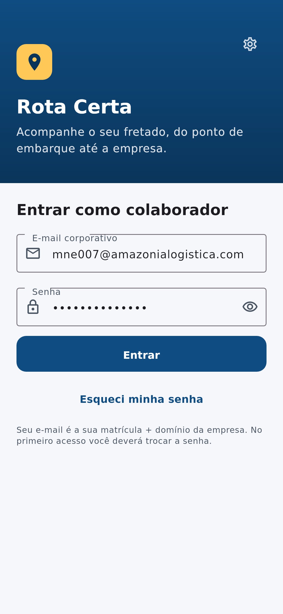
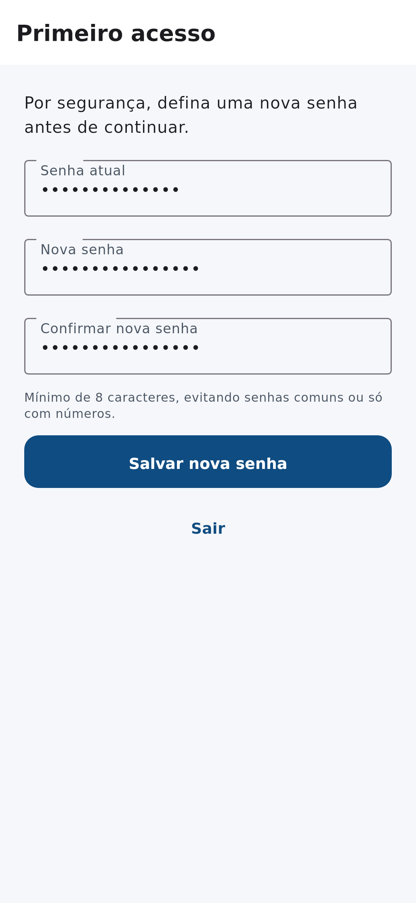
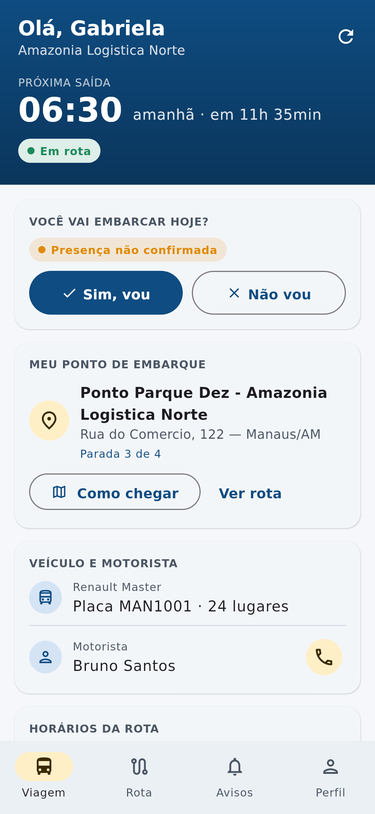
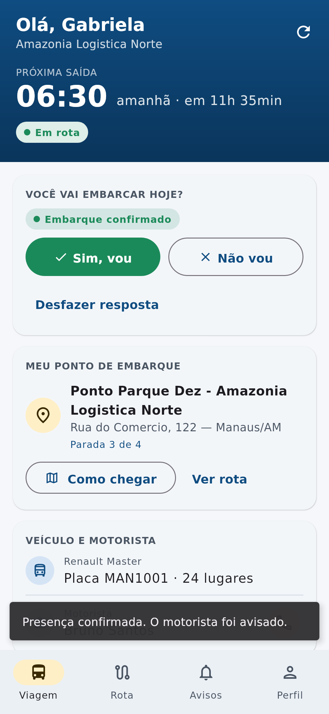
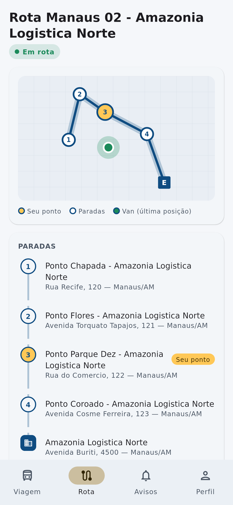
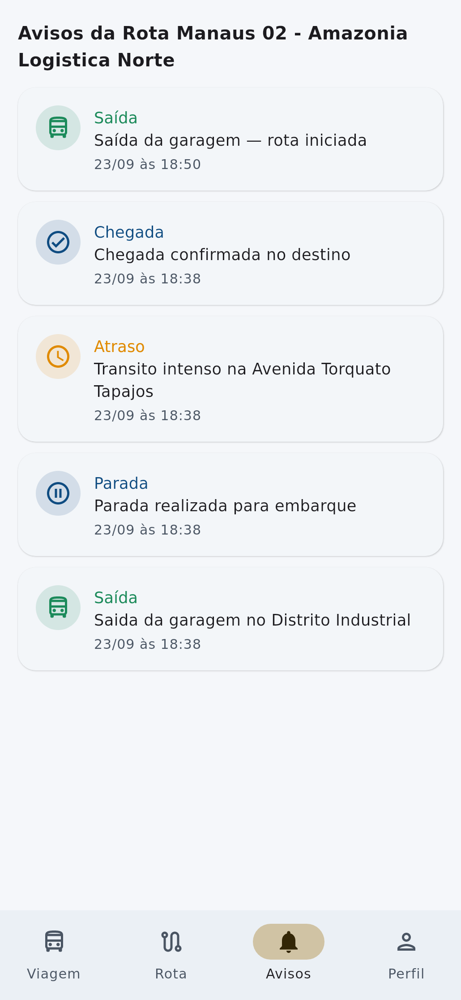
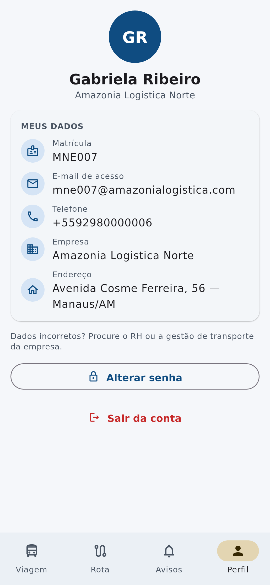

# 📱 Rota Certa — App do Colaborador (Android / Kotlin)

Protótipo do aplicativo **Android nativo** para os **colaboradores** (passageiros do fretado),
feito em **Kotlin + Jetpack Compose (Material 3)** e consumindo a API do
[backend Django](https://github.com/zezinjr/Rota-certa-Backend-Django).

| Login | Primeiro acesso | Minha viagem | Embarque confirmado |
|---|---|---|---|
|  |  |  |  |

| Rota | Avisos | Perfil |
|---|---|---|
|  |  |  |

> As capturas foram geradas executando este mesmo código Kotlin/Compose contra o backend
> rodando localmente com o seed `seed_manaus_demo` (renderização desktop; no Android
> as fontes/ícones seguem o padrão do sistema).

## ✨ Funcionalidades

- **Login** com e-mail corporativo (`matrícula@domínio-da-empresa`) e senha — JWT do backend.
- **Primeiro acesso**: troca de senha obrigatória quando `must_change_password = true`.
- **Esqueci minha senha**: fluxo por código (em modo DEBUG o backend devolve o código na resposta).
- **Minha viagem**: próxima saída (a partir dos horários da empresa) com contagem regressiva,
  status da rota (Aguardando / Em rota / Atrasado), ponto de embarque, veículo e motorista.
- **Confirmação de embarque**: “Sim, vou” / “Não vou” / desfazer — o motorista vê no app dele.
- **Rota**: mapa esquemático (sem SDK/chave de mapas) + timeline das paradas com o seu ponto destacado.
- **Avisos**: eventos da rota (saída, parada, atraso, ocorrência, chegada).
- **Perfil**: dados do colaborador, alterar senha e sair.
- Atualização automática a cada 30 s, renovação automática do token (refresh) e
  ações nativas: ligar para o motorista e abrir o ponto no app de mapas.

## 🧱 Arquitetura

```
app/src/main/java/br/com/rotacerta/colaborador/
├── data/
│   ├── model/        # DTOs kotlinx.serialization (espelham a API)
│   ├── remote/       # Retrofit + OkHttp (auth header, refresh de token, URL do servidor)
│   ├── session/      # SessionManager (StateFlow) + SessionStore
│   ├── RotaCertaRepository.kt
│   └── AppContainer.kt   # DI manual
├── ui/
│   ├── login/        # Login, primeiro acesso, recuperar senha
│   ├── trip/         # Viagem, Rota (mapa + timeline), Avisos, TripViewModel
│   ├── profile/
│   ├── navigation/   # Fluxo por estado de sessão + bottom navigation
│   ├── components/ · theme/
└── platform/         # MainActivity, Application, SharedPreferences, intents
```

MVVM com `ViewModel` + `StateFlow`/Compose state, Navigation Compose e injeção manual
(fácil de trocar por Hilt depois).

## 🔌 Endpoints usados (backend)

| Método | Endpoint | Uso |
|---|---|---|
| POST | `/api/auth/login/` | Login |
| POST | `/api/auth/refresh/` | Renovar access token |
| POST | `/api/auth/change-password/` | Primeiro acesso / alterar senha |
| POST | `/api/auth/password-reset/request/` · `reset/` | Recuperar senha |
| GET | `/api/me/` | Perfil do colaborador |
| GET | `/api/me/trips/` | Minhas viagens (rota, ponto, motorista, horários, eventos) |
| POST | `/api/me/trips/{id}/boarding/` | `{"status": "confirmed" \| "absent" \| "pending"}` |

Os endpoints `/api/me/*` exigem Bearer token de uma pessoa do tipo `EMPLOYEE`.

## ▶️ Como rodar

1. **Backend** (na pasta do backend):
   ```bash
   python -m venv .venv && source .venv/bin/activate
   pip install -r requirements.txt
   # .env: DEBUG=True, DATABASE_URL=sqlite:///db.sqlite3,
   #       ACCESS_ACCOUNT_AUTO_INITIAL_PASSWORD=RotaCerta@2026
   python manage.py migrate
   python manage.py seed_manaus_demo
   python manage.py runserver 0.0.0.0:8000
   ```
2. **App**: abra `mobile/colaborador-android` no **Android Studio** (Ladybug ou mais novo, JDK 17+)
   e rode no emulador. A URL padrão é `http://10.0.2.2:8000/api/` (o localhost do PC visto pelo emulador).
   Em celular físico, toque na **engrenagem** da tela de login e informe
   `http://IP-DO-PC:8000/api/` (mesma rede Wi-Fi).
3. **Usuário de teste** (seed): `mne007@amazonialogistica.com` / `RotaCerta@2026`
   (qualquer `mneXXX@<domínio da empresa>` funciona; o 1º acesso pede nova senha).

## ⚠️ Observações do protótipo

- HTTP liberado (`network_security_config`) só para testar com o `runserver`; em produção use HTTPS.
- Tokens em SharedPreferences privadas; para produção, prefira EncryptedSharedPreferences/Keystore.
- O status da rota é heurístico (último evento). Posição em tempo real depende do app do motorista
  enviar eventos/GPS periodicamente.
- Próximos passos sugeridos: notificações push (FCM) para atraso/chegada, mapa real
  (Google Maps Compose / osmdroid), modo offline e testes instrumentados.
